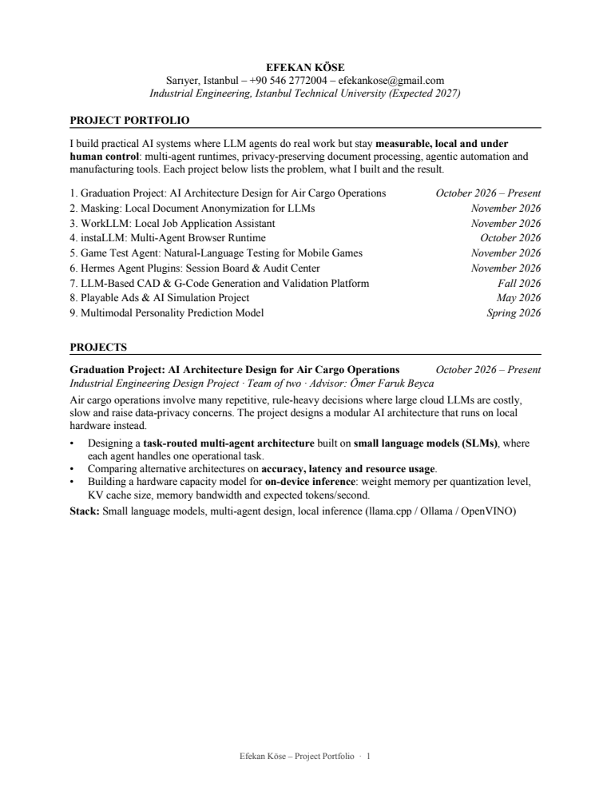

# Efekan Köse — Project Portfolio

**[📄 Open the portfolio (PDF)](Efekan_Kose_Portfolio.pdf)**

Industrial Engineering, Istanbul Technical University (Expected 2027).
Practical AI systems where LLM agents do real work but stay measurable, local and under human control.

| Project | Date |
|---|---|
| Graduation Project: AI Architecture Design for Air Cargo Operations | Oct 2026 – Present |
| Masking: Local Document Anonymization for LLMs | Nov 2026 |
| WorkLLM: Local Job Application Assistant | Nov 2026 |
| instaLLM: Multi-Agent Browser Runtime | Oct 2026 |
| Game Test Agent: Natural-Language Testing for Mobile Games | Nov 2026 |
| Hermes Agent Plugins: Session Board & Audit Center — [repo](https://github.com/immazella/hermes-plugins) | Nov 2026 |
| LLM-Based CAD & G-Code Generation and Validation Platform — [repo](https://github.com/immazella/llm-cad-gcode-platform) | Fall 2026 |
| Playable Ads & AI Simulation Project | May 2026 |
| Multimodal Personality Prediction Model | Spring 2026 |

Contact: efekankose@gmail.com
